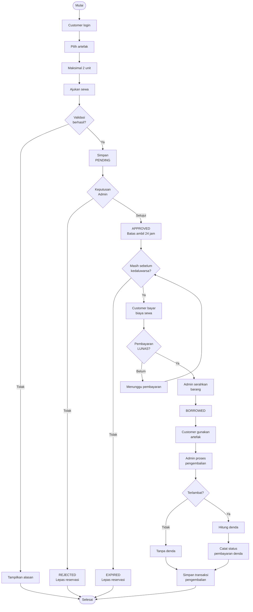
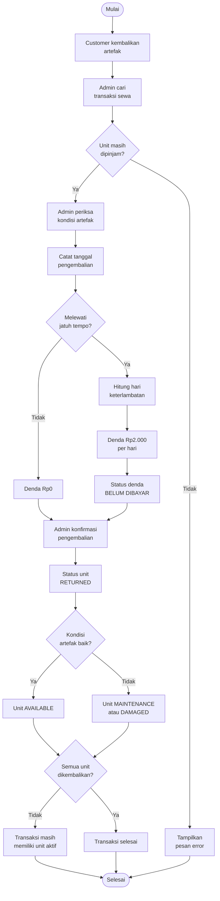
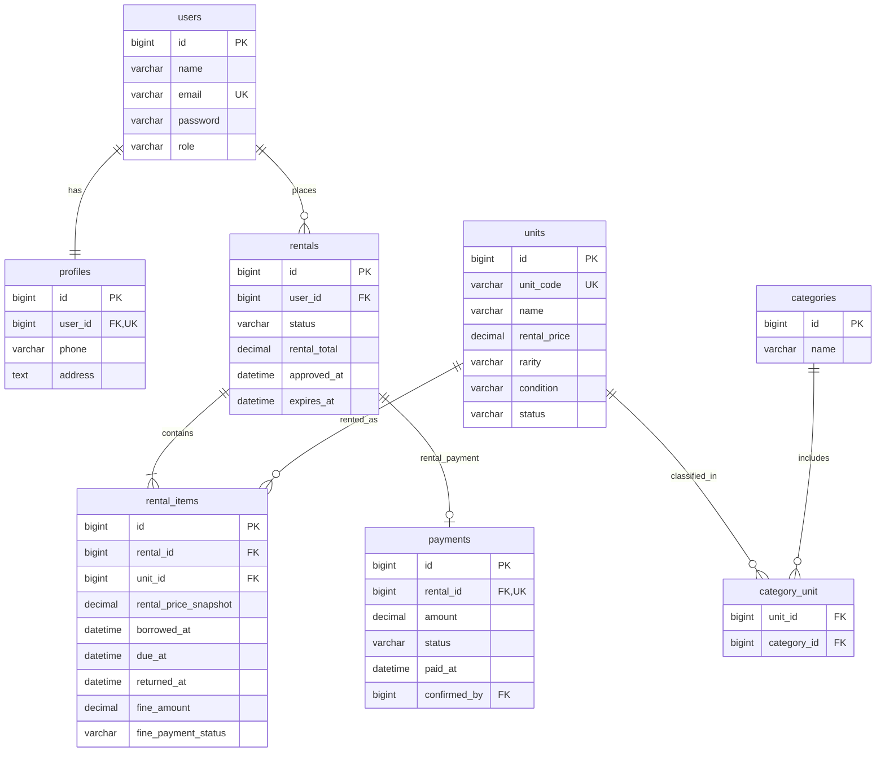

# 🧪 PotionVault — Magical Potion & Artifact Rental System

  
  
  
  
  
  
  
  

<strong>Sistem Penyewaan Ramuan dan Artefak Sihir Berbasis Web</strong>

Platform rental barang magis untuk pelanggan umum: katalog artefak, persetujuan penyewaan, pembayaran, pengembalian, denda, dan laporan.

  <a href="#overview">Overview</a> •
  <a href="#tech-stack">Tech Stack</a> •
  <a href="#brd--business-requirements-document">BRD</a> •
  <a href="#flowchart">Flowchart</a> •
  <a href="#erd--entity-relationship-diagram">ERD</a>

---

## 📖 Table of Contents

- [Overview](#overview)
- [Tech Stack](#tech-stack)
- [BRD — Business Requirements Document](#brd--business-requirements-document)
  - [Latar Belakang dan Tujuan](#latar-belakang-dan-tujuan)
  - [Aktor dan Fitur Utama](#aktor-dan-fitur-utama)
  - [Aturan Bisnis](#aturan-bisnis)
  - [Kebutuhan Nonfungsional](#kebutuhan-nonfungsional)
- [Flowchart](#flowchart)
  - [Alur Penyewaan](#alur-penyewaan)
  - [Alur Pengembalian dan Denda](#alur-pengembalian-dan-denda)
- [ERD — Entity Relationship Diagram](#erd--entity-relationship-diagram)

---

## Overview

**PotionVault** merupakan konsep platform penyewaan **botol ramuan dan artefak sihir yang dapat dipakai berulang kali** dalam dunia fantasi. Layanan ini **terbuka untuk masyarakat umum** yang telah terdaftar sebagai pelanggan, bukan khusus murid atau akademi sihir.

Pelanggan dapat mencari artefak, melihat kategori, efek fiktif, kelangkaan (*rarity*), tarif sewa dan ketersediaan, kemudian mengajukan penyewaan. Admin mengelola unit fisik, memutuskan persetujuan, mengonfirmasi pembayaran dan penyerahan, memproses pengembalian, serta mencetak laporan. Setiap barang fisik mempunyai **kode unit yang unik**, meskipun beberapa barang memiliki nama sama.

Contoh koleksi:

| Kode Unit | Nama Artefak | Rarity | Contoh Tarif per Periode (hingga 5 hari) |
|---|---|---|---:|
| HEAL-001 | Healing Potion Vessel | Common | Rp10.000 |
| INVS-001 | Invisibility Flask | Rare | Rp20.000 |
| MANA-001 | Mana Crystal Bottle | Common | Rp15.000 |
| TIME-001 | Time Freeze Vessel | Legendary | Rp50.000 |

> Tarif pada tabel merupakan **contoh rancangan awal** dan dapat diatur admin. Objek yang disewakan adalah wadah/artefak magis yang wajib dikembalikan, bukan ramuan sekali konsumsi.

## Tech Stack

Badge di bagian atas menunjukkan teknologi yang **direncanakan**:

- **Laravel + PHP** — backend, routing, validasi, autentikasi, dan logika transaksi.
- **MySQL** — penyimpanan data relasional.
- **Laravel Blade** — templating antarmuka.
- **Tailwind CSS** — desain responsif bernuansa *dark fantasy*.
- **Alpine.js** — interaksi sederhana pada antarmuka.
- **Chart.js** — grafik ringkasan dashboard.
- **Git + GitHub** — version control dan repository proyek.

> Versi dependensi akan ditentukan setelah inisialisasi proyek Laravel; badge sengaja tidak mengklaim versi tertentu.

---

## BRD — Business Requirements Document

### Latar Belakang dan Tujuan

Sebagai studi kasus fiktif, bisnis penyewaan barang sihir membutuhkan sistem terpusat untuk mencatat aset, ketersediaan, identitas pelanggan, permohonan sewa, tarif, pembayaran, pengembalian, dan denda. PotionVault bertujuan menghindari pencatatan yang terpisah, benturan reservasi barang, serta kesulitan memantau status transaksi.

Tujuan proyek adalah menyediakan layanan penyewaan melalui web yang dapat diawasi admin, menjaga setiap unit inventaris dapat ditelusuri, dan menghasilkan riwayat transaksi serta laporan yang dapat dicetak.

### Aktor dan Fitur Utama

**Admin / Potion Keeper**

- Login dan mengelola profil sendiri.
- CRUD unit artefak, kategori, serta pelanggan.
- Menentukan kode unit unik, kategori jamak, kondisi, rarity, foto, dan tarif sewa.
- Memproses pengajuan **approve/reject**.
- Mengonfirmasi pembayaran sewa sebelum barang diserahkan.
- Mengonfirmasi penyerahan dan pengembalian unit.
- Melihat/mengelola denda, termasuk status **BELUM DIBAYAR / LUNAS**.
- Memantau semua penyewaan dan mencetak riwayat/laporan.

**User / Customer**

- Login dan mengelola profil sendiri.
- Melihat katalog, mencari berdasarkan nama dan memfilter kategori.
- Mengajukan penyewaan barang yang tersedia.
- Melihat status pengajuan, rincian tarif, pinjaman aktif, tagihan, denda, dan riwayat sendiri.

### Aturan Bisnis

| ID | Aturan |
|---|---|
| BR-01 | Semua pengguna wajib login untuk mengakses fitur operasional; pelanggan harus terdaftar. |
| BR-02 | Setiap user memiliki tepat satu profil dan dapat mengubahnya sendiri. |
| BR-03 | Tiap unit fisik memiliki **kode unik**; nama unit boleh sama. |
| BR-04 | Satu unit dapat memiliki beberapa kategori (*many-to-many*). |
| BR-05 | Pelanggan maksimal memiliki **2 unit aktif**; status PENDING dan APPROVED juga memesan kuota. |
| BR-06 | Pengajuan memerlukan keputusan admin sebelum serah terima. |
| BR-07 | Persetujuan berlaku **24 jam**; tanpa serah terima sampai batas waktu, status menjadi EXPIRED dan reservasi dilepas. |
| BR-08 | Tarif sewa tetap dikenakan **per periode hingga 5 hari**, berdasarkan unit yang dipilih; nominal transaksi disimpan sebagai snapshot. |
| BR-09 | Biaya sewa harus **LUNAS sebelum penyerahan**; pembayaran dilakukan di luar aplikasi dan dikonfirmasi admin. |
| BR-10 | Masa sewa dimulai saat admin mengonfirmasi penyerahan; masa tanpa denda adalah **5 hari**. |
| BR-11 | Keterlambatan dikenai denda **Rp2.000 per hari per unit**. |
| BR-12 | Pengembalian hanya dikonfirmasi admin, termasuk kondisi unit setelah kembali. |
| BR-13 | Denda dicatat terpisah dari pembayaran biaya sewa; statusnya BELUM DIBAYAR atau LUNAS untuk denda positif. |
| BR-14 | Denda belum dibayar **tidak menghalangi** penyewaan baru bila persyaratan lain terpenuhi. |
| BR-15 | Pelanggan hanya melihat transaksinya sendiri; admin melihat semua dan bisa mencetak laporan. |
| BR-16 | Unit rusak/perawatan tidak boleh disewa; transaksi historis tetap dipertahankan. |

**Perhitungan denda:** `hari_terlambat × Rp2.000 × jumlah unit terlambat`, dihitung per unit menurut waktu pengembalian masing-masing. Untuk rancangan awal, bagian dari periode 24 jam keterlambatan dihitung sebagai satu hari.

**Status penyewaan:** `PENDING`, `APPROVED`, `REJECTED`, `EXPIRED`, `BORROWED`, `OVERDUE` (diturunkan dari jatuh tempo), dan `RETURNED`. Pengembalian parsial dilacak pada masing-masing item transaksi.

### Kebutuhan Nonfungsional

- Otorisasi berbasis role dan proteksi setiap endpoint backend.
- Hashing password, validasi server-side, dan pembatasan akses data pelanggan.
- Integritas data melalui *foreign key*, *unique constraint*, dan transaksi database untuk reservasi/pembayaran/penyerahan.
- Antarmuka responsif, konsistensi tampilan, dan pencatatan waktu serta petugas untuk tindakan penting.
- Penggunaan migration dan seeder Laravel untuk struktur dan contoh data awal.

---

## Flowchart

Diagram berikut menggunakan **Mermaid** dan dapat ditampilkan oleh renderer Markdown yang mendukung Mermaid.

### Alur Penyewaan

> Pembayaran dan serah terima sebaiknya dilakukan dalam satu proses checkout admin. Jika pembayaran telah dicatat tetapi serah terima tidak jadi dilakukan, admin harus menangani koreksi/pengembalian dana secara eksplisit; rincian alur pengecualian akan difinalisasi pada PRD.

### Alur Pengembalian dan Denda

Admin dapat mengubah status denda menjadi **LUNAS** setelah pembayaran di luar sistem terkonfirmasi. Informasi pengembalian dan pembayaran dicatat untuk kebutuhan riwayat serta laporan.

---

## ERD — Entity Relationship Diagram

Rancangan awal memakai **8 tabel inti**. Atribut dan relasi final akan disesuaikan saat menulis migration Laravel.

**Penjelasan relasi:**

- `users` **1:1** `profiles`: setiap akun memiliki satu profil (`profiles.user_id` unik).
- `users` **1:N** `rentals`: satu pelanggan dapat melakukan banyak transaksi seiring waktu.
- `rentals` **1:N** `rental_items`: satu transaksi memiliki satu atau dua item.
- `units` **1:N** `rental_items`: satu unit dapat muncul dalam banyak transaksi historis, namun tidak boleh aktif dalam dua transaksi sekaligus.
- `units` **M:N** `categories`: diperantarai `category_unit`.
- `rentals` **1:0..1** `payments`: satu catatan pembayaran sewa pada rancangan awal, termasuk tagihan yang belum lunas; pembayaran denda dicatat per item secara terpisah.

**Catatan desain:** Kolom `confirmed_by` pada `payments` merujuk `users.id` milik admin. Pada migration final diperlukan kolom tambahan untuk persetujuan, pelunasan denda per item, kondisi pengembalian, timestamps, dan *soft deletes* sesuai kebutuhan. Status `OVERDUE` sebaiknya dihitung dari tenggat tiap item agar pengembalian sebagian tetap akurat.

---

> **Status proyek:** tahap dokumentasi dan perancangan. Desain, migration, seeder, implementasi, UAT, dan dokumentasi demo akan ditambahkan pada tahapan berikutnya.
