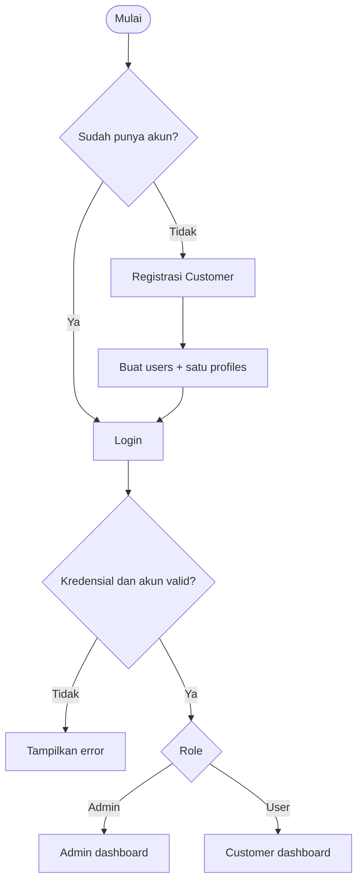
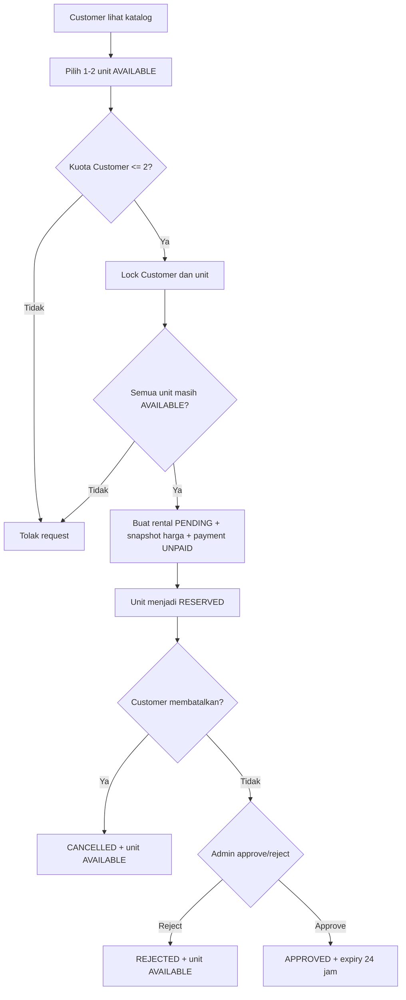
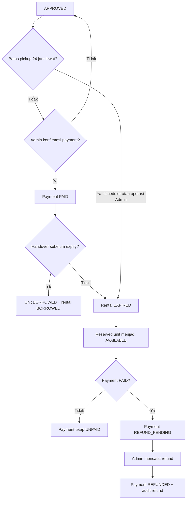
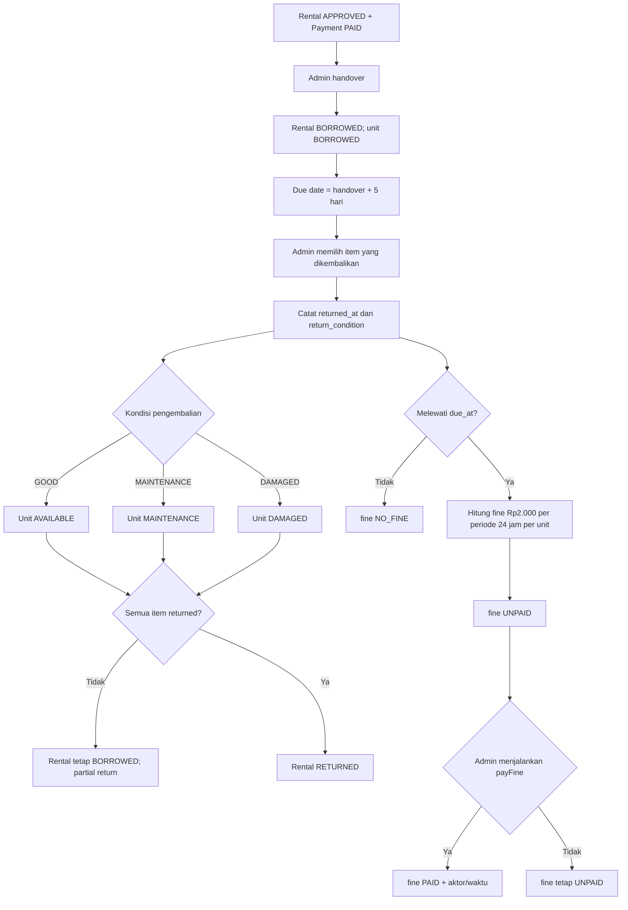
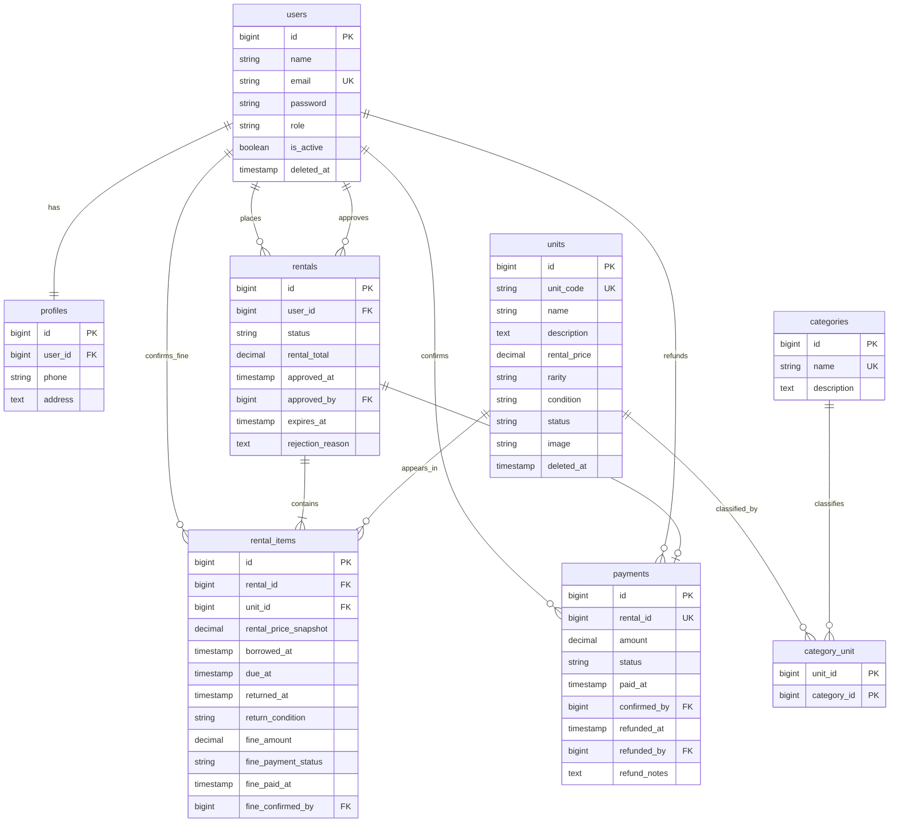

# 🧪 PotionVault — Magical Potion & Artifact Rental System

<p align="center"><strong>Sistem Penyewaan Ramuan dan Artefak Sihir Berbasis Web</strong></p>

<p align="center">
  
  
  
  
  
  
</p>

> Katalog, reservasi, approval, pembayaran manual, handover, return, denda, refund, dashboard, dan laporan dalam satu aplikasi PotionVault.

PotionVault adalah aplikasi Laravel untuk mengelola penyewaan unit fisik artefak/ramuan magis. Aplikasi ini mendukung katalog publik, akun Customer, operasi Admin, reservasi, approval, pembayaran manual, handover, pengembalian per unit, denda, refund, dashboard, dan laporan.

## Informasi proyek

| Item | Detail |
|---|---|
| Nama proyek | PotionVault |
| Nama kelompok | **SahabatClaude** |
| Anggota | **Darvesh Gladwin Musyaffa** |
| Platform | Web |
| Status | Automated UAT dan manual testing selesai |
| Repository | [github.com/gladwin-ui/PotionVault-WEB](https://github.com/gladwin-ui/PotionVault-WEB) |
| Manual book admin | [Google Drive](https://drive.google.com/file/d/1XiAaMDjWUGs87ZpL4MarMbyr9gIkoe6d/view?usp=sharing) |
| Manual book customer | [Google Drive](https://drive.google.com/file/d/1Dq4Wp33Eho_wkbADNlX8VuZHah9Vw2Yd/view?usp=sharing) |

## Dokumentasi navigasi

- [PRD PotionVault](docs/PRD_PotionVault.md)
- [BRD Final](docs/PotionVault_BRD_Final.md)
- [ERD Final](docs/PotionVault_ERD_Final.md)
- [Flowchart Final](docs/PotionVault_Flowcharts_Final.md)
- [Formal UAT Final](docs/PotionVault_UAT_Final.md)
- [Full Deliverable Report](docs/full-deliverable-report.md)
- [Gap Analysis dan Traceability](docs/PotionVault_Deliverable_Gap_Analysis.md)

## Tech stack

- Laravel 13, PHP 8.3+, Composer
- MySQL 8+ untuk aplikasi dan concurrency testing
- Blade, Vite, Tailwind CSS, Alpine.js, Chart.js
- PHPUnit/Laravel Feature Test dan Playwright Chromium
- Storage publik Laravel untuk foto artefak; path foto disimpan pada kolom `units.image`

## Role dan fitur

### Customer/User

- Registrasi, login, logout, dan edit profil sendiri.
- Mengubah password dengan verifikasi password saat ini.
- Melihat katalog, mencari nama/kode unit, serta memfilter kategori dan rarity.
- Melihat detail unit dan foto artefak.
- Mengajukan satu atau dua unit dalam satu rental.
- Melihat status rental, tagihan, payment, jatuh tempo, denda, dan histori milik sendiri.
- Membatalkan pengajuan hanya ketika status masih `PENDING`.

### Admin

- Login dan edit profil/password sendiri.
- CRUD unit artefak, kategori, dan Customer.
- Upload, mengganti, dan menghapus foto artefak.
- Menetapkan beberapa kategori untuk satu unit.
- Mengaktifkan, menonaktifkan, menghapus aman, dan memulihkan Customer.
- Approve/reject rental, konfirmasi pembayaran, handover, return per unit, pelunasan denda, dan refund.
- Melihat dashboard KPI, grafik rarity, tren rental, serta laporan dengan filter dan print browser.

## Aturan bisnis dan status

- Semua fitur operasional membutuhkan login; Customer harus terdaftar.
- Setiap akun memiliki satu `profile` melalui constraint unik `profiles.user_id`.
- Nama unit boleh sama, tetapi `unit_code` wajib unik.
- Satu unit dapat memiliki banyak kategori melalui tabel pivot `category_unit`.
- Customer maksimal memiliki dua unit aktif. Rental `PENDING`, `APPROVED`, dan `BORROWED` ikut menghitung kuota.
- Rental disimpan sebagai `PENDING` dan unit terkait menjadi `RESERVED`.
- Approval Admin menetapkan batas pengambilan 24 jam (`expires_at`).
- Rental yang melewati batas pengambilan menjadi `EXPIRED` dan unit `RESERVED` dilepas.
- Jika rental expired sudah `PAID`, payment menjadi `REFUND_PENDING`; Admin dapat mencatatnya sebagai `REFUNDED`. Histori payment dipertahankan.
- Handover hanya boleh untuk rental `APPROVED`, payment `PAID`, dan unit `RESERVED`.
- Masa sewa adalah lima hari sejak handover. Pengembalian dapat dilakukan per unit.
- Denda adalah Rp2.000 untuk setiap periode keterlambatan 24 jam yang dimulai per unit.
- Return `GOOD` mengembalikan unit menjadi `AVAILABLE`; kondisi `MAINTENANCE` atau `DAMAGED` mempertahankan unit pada status tersebut.
- Customer hanya dapat melihat rental miliknya; Admin dapat melihat seluruh data.

Status utama:

| Domain | Status |
|---|---|
| Rental | `PENDING`, `APPROVED`, `REJECTED`, `CANCELLED`, `EXPIRED`, `BORROWED`, `RETURNED` |
| Payment sewa | `UNPAID`, `PAID`, `REFUND_PENDING`, `REFUNDED` |
| Unit | `AVAILABLE`, `RESERVED`, `BORROWED`, `MAINTENANCE`, `DAMAGED`, `DEACTIVATED` |
| Fine per item | `NO_FINE`, `UNPAID`, `PAID` |

## Ringkasan BRD

PotionVault menggantikan pencatatan manual penyewaan artefak dengan sistem terpusat untuk katalog, reservasi, approval, pembayaran manual, handover, return, fine, refund, dan laporan.

Ruang lingkup utama:

- Admin mengelola unit artefak, kategori, Customer, approval, payment, handover, return, denda, refund, dashboard, dan report.
- Customer terdaftar dapat mengelola profil, mencari katalog, melihat detail artefak, membuat rental maksimal dua unit, membatalkan rental `PENDING`, dan melihat transaksi miliknya.
- Setiap unit memiliki `unit_code` unik, dapat memiliki banyak kategori, dan menyimpan kondisi, rarity, harga, status, serta foto.
- Unit menggunakan soft delete tanpa fitur restore Admin; Customer menggunakan soft delete dan dapat di-restore; kategori hanya dapat dihapus jika belum digunakan. Histori transaksi tetap dipertahankan.
- Sistem tidak mencakup payment gateway, aplikasi mobile native, pengiriman fisik, atau efek sihir nyata.

Aturan bisnis inti: rental aktif Customer maksimal dua item; request mengunci Customer dan unit dalam transaksi; approval berlaku 24 jam; handover membutuhkan payment `PAID`; masa sewa lima hari; fine Rp2.000 per periode keterlambatan 24 jam per unit; return dapat parsial; dan rental menjadi `RETURNED` setelah semua item kembali.

## Ringkasan PRD

| Area | Ringkasan implementasi |
|---|---|
| Authentication | Registration Customer, login/logout, role guard Admin/Customer, akun aktif, dan profile tunggal. |
| Customer | Katalog, pencarian nama/kode, filter kategori/rarity, detail artefak, rental 1–2 unit, dashboard, billing, histori, dan ownership isolation. |
| Admin | CRUD artefak/kategori/Customer, foto artefak, kategori jamak, dashboard KPI/chart, approval/rejection, payment, handover, return, fine, refund, dan report print. |
| Workflow | `PENDING` → `APPROVED`/`REJECTED` → `BORROWED` → `RETURNED`, termasuk cancel, expiry, partial return, fine, dan refund. |
| Nonfungsional | Server-side validation, password hashing, authorization, foreign key/unique constraint, transaction/row locking, migration/seeder, dan responsive Blade UI. |

Acceptance criteria utama telah diverifikasi melalui Laravel Feature Test, Playwright Chromium, MySQL concurrency test, dan UAT formal.

## Flowchart lengkap

### Registration dan login



### Rental request sampai approval



### Expiry, payment, handover, dan refund



### Handover, return, fine, dan completion



## ERD dan penjelasan schema

ERD berikut memodelkan business schema utama PotionVault. Tabel framework Laravel seperti `sessions`, `cache`, `jobs`, dan `password_reset_tokens` tidak ditampilkan dalam ERD bisnis.



Relasi penting:

- `users` memiliki satu `profiles` dan dapat memiliki banyak `rentals`.
- `rentals` memiliki satu atau lebih `rental_items` dan paling banyak satu `payments`.
- `units` terhubung ke `categories` melalui pivot `category_unit`.
- `rental_items` menyimpan snapshot harga, waktu handover/due/return, kondisi, fine, dan audit pembayaran fine.
- `payments` menyimpan status pembayaran, konfirmasi Admin, dan audit refund.
- Constraint penting: email, unit code, category name, profile user, payment rental, serta pasangan rental-item bersifat unik sesuai migration.

## Instalasi dan konfigurasi MySQL

```powershell
composer install
npm install
Copy-Item .env.example .env
php artisan key:generate
```

Buat database MySQL, lalu sesuaikan `.env`:

```env
DB_CONNECTION=mysql
DB_HOST=127.0.0.1
DB_PORT=3306
DB_DATABASE=potionvault
DB_USERNAME=root
DB_PASSWORD=
```

Jalankan migration dan seeder:

```powershell
php artisan migrate --seed
php artisan storage:link
```

Seeder menyediakan akun contoh:

- Admin: `admin@potionvault.test` / `password`
- Customer: `aria@potionvault.test` / `password`

Ganti kredensial contoh untuk lingkungan non-development.

## Menjalankan aplikasi

Terminal pertama:

```powershell
php artisan serve
```

Terminal kedua:

```powershell
npm.cmd run dev
```

Buka `http://127.0.0.1:8000`.

## Testing dan quality checks

### Laravel Feature Test

`php artisan test` menggunakan environment testing terisolasi sesuai `phpunit.xml` dan tidak boleh diarahkan ke database development.

### Playwright Chromium UAT

Playwright memakai Chromium lokal, `workers: 1`, dan base URL default `http://127.0.0.1:8001` dari `playwright.config.js`. Jalankan server dengan database serta storage UAT terpisah:

```powershell
# Jalankan dari root repository; gunakan database UAT, bukan potionvault development.
$env:DB_DATABASE = 'potionvault_uat_test'
$env:LARAVEL_STORAGE_PATH = (Join-Path (Get-Location) 'uat-runtime-storage')
New-Item -ItemType Directory -Force $env:LARAVEL_STORAGE_PATH | Out-Null

php artisan config:clear
php artisan migrate:fresh --seed --force
php artisan serve --host=127.0.0.1 --port=8001
```

Pada terminal kedua, jalankan test browser:

```powershell
$env:BROWSER_BASE_URL = 'http://127.0.0.1:8001'
npx playwright test
```

Setelah selesai, hentikan server dan hapus hanya folder runtime UAT yang dibuat untuk pengujian. Jangan menjalankan `migrate:fresh` pada database development dan jangan menghapus `storage/app/public` yang berisi gambar aplikasi.

### Regression commands

```powershell
php artisan test
npx playwright test
php artisan route:list
php artisan view:cache
npm.cmd run build
```

Hasil verifikasi terakhir:

- Laravel: 40 test, 200 assertion, semuanya PASS.
- Playwright Chromium: 20 test PASS pada desktop, tablet, dan mobile.
- Route: 54 route.
- Blade view cache: PASS.
- Vite build: PASS; masih ada warning nonfatal terkait optional `fontaine` dan referensi gambar dokumentasi.

Formal UAT Sprint 3.1:

- 81 dari 81 skenario UAT PASS.
- FAIL: 0; BLOCKED: 0; NOT RUN: 0.
- Database concurrency MySQL terisolasi: PASS.
- Evidence screenshot tersedia di [docs/uat/evidence](docs/uat/evidence).
- Manual testing telah dilakukan oleh tim proyek.
- Status automated UAT: `81/81 PASS`; human acceptance/sign-off formal masih pending. Detail tersedia pada [PotionVault_UAT_Final.md](docs/PotionVault_UAT_Final.md).

## Struktur penting

```text
app/Http/Controllers/   Controller Customer, Admin, dan Auth
app/Models/              Model Eloquent
app/Services/            Workflow rental dan expiry
database/migrations/     Schema database
database/seeders/        Data awal
resources/views/         Blade UI
resources/css/           Styling PotionVault
routes/web.php           Route aplikasi
tests/Feature/           Laravel feature tests
tests/browser/           Playwright tests
docs/                    PRD, BRD, ERD, flowchart, dan laporan
```

## Schema database

Schema final diringkas pada [ERD Final](docs/PotionVault_ERD_Final.md). Tabel aktual: `users`, `profiles`, `units`, `categories`, `category_unit`, `rentals`, `rental_items`, dan `payments`. Kolom, key, index, soft delete, expiry, return, fine, image, dan refund mengikuti migration Laravel aktual.
