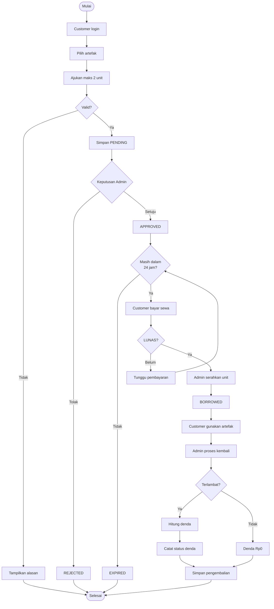
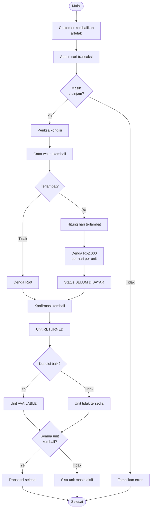

# 🧪 PotionVault — Product Requirements Document (PRD)

  
  
  
  
  

<strong>Sistem Penyewaan Ramuan dan Artefak Sihir Berbasis Web</strong>

Spesifikasi produk untuk implementasi Laravel: halaman, peran, fitur, validasi, proses rental, pembayaran, pengembalian, denda, dan pengujian.

<a href="#1-ringkasan-produk">Overview</a> • <a href="#3-hak-akses">Roles</a> • <a href="#4-spesifikasi-fitur-customer">Customer</a> • <a href="#5-spesifikasi-fitur-admin">Admin</a> • <a href="#6-aturan-bisnis">Business Rules</a> • <a href="#9-acceptance-criteria-dan-uat">UAT</a>

---

## 📖 Table of Contents

- [Identitas dokumen](#identitas-dokumen)
- [1. Ringkasan Produk](#1-ringkasan-produk)
- [2. Tujuan dan Ruang Lingkup](#2-tujuan-dan-ruang-lingkup)
- [3. Hak Akses](#3-hak-akses)
- [4. Spesifikasi Fitur Customer](#4-spesifikasi-fitur-customer)
- [5. Spesifikasi Fitur Admin](#5-spesifikasi-fitur-admin)
- [6. Aturan Bisnis](#6-aturan-bisnis)
- [7. Status dan Alur Transaksi](#7-status-dan-alur-transaksi)
- [8. Persyaratan Data dan Teknis](#8-persyaratan-data-dan-teknis)
- [9. Acceptance Criteria dan UAT](#9-acceptance-criteria-dan-uat)
- [10. Prioritas Implementasi](#10-prioritas-implementasi)
- [11. Risiko dan Penanganan](#11-risiko-dan-penanganan)
- [12. Catatan Keputusan](#12-catatan-keputusan)

---

## Identitas Dokumen

| Informasi | Detail |
|---|---|
| Nama proyek | PotionVault |
| Judul | Sistem Penyewaan Ramuan dan Artefak Sihir Berbasis Web |
| Jenis dokumen | Product Requirements Document (PRD) |
| Versi | 1.0 — Draft acuan implementasi |
| Tanggal penyusunan | 22 Oktober 2026 |
| Platform | Web |
| Role | Admin / Potion Keeper dan User / Customer |
| Stack | Laravel, PHP, MySQL, Blade, Tailwind CSS, Alpine.js, Chart.js |
| Pembayaran | Manual, dikonfirmasi Admin; tanpa payment gateway |

## 1. Ringkasan Produk

PotionVault merupakan platform penyewaan **berbayar** untuk masyarakat umum dalam latar dunia fantasi. Barang yang disewakan adalah **botol ramuan magis dan artefak sihir yang dapat digunakan berulang kali** dan wajib dikembalikan setelah masa sewa. Setiap unit fisik memiliki kode unik, harga sewa, kategori, tingkat kelangkaan (*rarity*), kondisi, dan status ketersediaan.

Customer yang sudah terdaftar dapat menelusuri katalog, mengajukan maksimal dua unit aktif, memantau persetujuan dan tagihan, serta melihat riwayat dan denda. Admin mengelola katalog, akun pelanggan, persetujuan, pembayaran, penyerahan, pengembalian, dan laporan.

## 2. Tujuan dan Ruang Lingkup

### 2.1 Tujuan

1. Mengelola inventaris artefak secara terpusat dengan **kode unit unik**.
2. Menyediakan katalog dengan pencarian nama, kategori, rarity, tarif, dan ketersediaan.
3. Memfasilitasi penyewaan dengan persetujuan Admin dan batas dua unit aktif per Customer.
4. Memisahkan biaya sewa dari denda keterlambatan beserta status pembayarannya.
5. Mendukung pengembalian per unit, histori transaksi, monitoring, dan cetak laporan.

### 2.2 In Scope (MVP)

- Login, logout, registrasi pelanggan, dan pengelolaan profil satu-ke-satu.
- CRUD Admin untuk artefak, kategori, dan pelanggan.
- Katalog, detail artefak, pencarian, dan filter.
- Pengajuan, approval/rejection, tenggat ambil 24 jam, dan konfirmasi penyerahan.
- Konfirmasi pembayaran sewa manual sebelum penyerahan.
- Durasi sewa tanpa denda lima hari sejak penyerahan, pengembalian oleh Admin, dan denda otomatis.
- Status denda `BELUM DIBAYAR` / `LUNAS`, riwayat, laporan, migration, seeder, dan validasi.

### 2.3 Out of Scope

Payment gateway, checkout mandiri tanpa Admin, pengiriman barang, aplikasi mobile native, integrasi pihak ketiga, dan simulasi efek sihir.

## 3. Hak Akses

| Aktivitas | Admin | Customer |
|---|:---:|:---:|
| Login, logout, edit profil sendiri | ✅ | ✅ |
| Registrasi pelanggan umum | — | ✅ |
| CRUD artefak, kategori, dan pelanggan | ✅ | ❌ |
| Lihat katalog dan cari artefak | ✅ | ✅ |
| Ajukan sewa | — | ✅ |
| Setujui/tolak sewa | ✅ | ❌ |
| Konfirmasi pembayaran biaya sewa | ✅ | ❌ |
| Konfirmasi serah-terima/pengembalian | ✅ | ❌ |
| Konfirmasi pelunasan denda | ✅ | ❌ |
| Lihat semua transaksi dan cetak laporan | ✅ | ❌ |
| Lihat transaksi milik sendiri | — | ✅ |

> Nama role dalam database tetap `admin` dan `user`. Istilah **Potion Keeper** dan **Customer** digunakan dalam tampilan.

## 4. Spesifikasi Fitur Customer

### PRD-CUS-01 — Registrasi dan Login

- **Halaman:** Register, Login.
- **Input register:** nama, email, nomor telepon, password, konfirmasi password.
- **Validasi:** semua input wajib kecuali data opsional yang dinyatakan; email valid dan unik; password minimal delapan karakter; konfirmasi cocok; nomor telepon sesuai format.
- **Hasil:** akun role `user` beserta satu profil dibuat; pengguna dapat login. Halaman operasional membutuhkan sesi aktif.
- **Keamanan:** kredensial salah menghasilkan pesan umum; sesi logout diakhiri dengan benar.

### PRD-CUS-02 — Profil

- **Halaman:** Profil Saya.
- **Isi:** nama, email, telepon, alamat dan pengaturan akun yang diizinkan.
- **Aksi:** lihat dan edit profil sendiri.
- **Validasi:** email tetap unik; pelanggan tidak dapat mengedit profil pengguna lain.

### PRD-CUS-03 — Dashboard

- **Halaman:** Dashboard Customer.
- **Isi:** jumlah unit aktif, pengajuan `PENDING`/`APPROVED`, jatuh tempo terdekat, denda belum lunas, dan transaksi terbaru.
- **Aturan:** semua statistik hanya berasal dari data Customer yang sedang login.

### PRD-CUS-04 — Katalog Artefak

- **Halaman:** Katalog.
- **Elemen:** kolom pencarian berdasarkan nama, filter kategori/rarity, foto, nama, kode unit, harga per periode, status, pagination, tombol Detail.
- **Perilaku:** hasil bisa difilter dan dicari; artefak tidak tersedia boleh terlihat tetapi tidak dapat dipilih untuk penyewaan.

### PRD-CUS-05 — Detail Artefak

- **Halaman:** Detail Produk.
- **Isi:** nama, kode unit unik, gambar, deskripsi, efek magis fiktif, kategori, rarity (`Common`, `Rare`, `Epic`, `Legendary`), kondisi, harga, status, aturan lima hari.
- **Aksi:** Tambah ke Pengajuan jika masih tersedia; validasi ulang tetap dilakukan server saat submit.

### PRD-CUS-06 — Pengajuan Rental

- **Halaman:** Form Pengajuan.
- **Isi:** satu atau dua unit berbeda, harga masing-masing, subtotal/total biaya, syarat pembayaran, masa sewa, dan batas pengambilan.
- **Validasi:** akun aktif; unit tersedia; satu unit tidak dipilih dua kali; jumlah unit aktif ditambah pengajuan baru **maksimal dua**; validasi terakhir dilakukan atomik saat penyimpanan.
- **Hasil:** status `PENDING`; harga unit disalin sebagai *price snapshot*; unit dialokasikan sementara sehingga tidak bisa diajukan Customer lain.
- **Catatan:** denda lama yang belum lunas **tidak** memblokir pengajuan selama syarat lainnya dipenuhi.

### PRD-CUS-07 — Sewa Saya

- **Halaman:** Daftar Rental dan Detail Rental.
- **Isi:** nomor transaksi, daftar unit, waktu pengajuan, keputusan Admin, batas pengambilan, biaya sewa, status pembayaran, waktu penyerahan/jatuh tempo, status unit, dan pengembalian.
- **Status tampilan:** `PENDING`, `APPROVED`, `REJECTED`, `EXPIRED`, `BORROWED`, `OVERDUE`, `RETURNED`.
- **Akses:** Customer hanya melihat transaksinya sendiri.

### PRD-CUS-08 — Riwayat, Tagihan, dan Denda

- **Halaman:** Riwayat Saya / Tagihan.
- **Isi:** transaksi historis, rincian biaya sewa, pembayaran, tanggal kembali, denda per unit, serta status pelunasan.
- **Akses:** hanya baca; Customer tidak dapat menandai pembayaran sebagai lunas atau memproses pengembalian.

## 5. Spesifikasi Fitur Admin

### PRD-ADM-01 — Dashboard Admin

- **Statistik:** total unit, unit tersedia, unit disewa, pending, terlambat, pelanggan, pembayaran sewa terkonfirmasi, dan denda belum lunas.
- **Elemen:** grafik transaksi (Chart.js) dan daftar aktivitas terbaru.
- **Catatan:** pendapatan sewa hanya dari pembayaran berstatus `LUNAS`.

### PRD-ADM-02 — Manajemen Artefak (CRUD Produk)

Admin dapat **menambah, melihat, mengubah, dan menghapus secara aman/menonaktifkan produk**.

| Field | Validasi | Contoh |
|---|---|---|
| Nama artefak | Required; boleh sama dengan unit lain | Invisibility Flask |
| Kode unit | Required; **unique** | `INVS-001` |
| Deskripsi | Required | Botol penyamaran magis |
| Efek sihir | Opsional | Efek ilusi |
| Kategori | Minimal satu, multiple | Illusion, Shadow |
| Rarity | Salah satu nilai valid | Rare |
| Harga sewa | Angka >= 0 | Rp20.000/periode |
| Kondisi | Baik/Perawatan/Rusak | Baik |
| Foto | File gambar; validasi tipe/ukuran | `invisibility.jpg` |

- Setiap **unit fisik** adalah satu record dengan kode unik; nama produk boleh berulang, misalnya `INVS-001` dan `INVS-002`.
- Perubahan harga hanya berlaku untuk pengajuan baru; harga historis tetap dari snapshot transaksi.
- Unit aktif tidak dapat dihapus. Data bersejarah dipertahankan melalui penonaktifan atau soft delete.

### PRD-ADM-03 — Kategori (CRUD)

- **Field:** nama kategori wajib, deskripsi opsional.
- **Aturan:** satu unit dapat memiliki lebih dari satu kategori melalui tabel pivot; penghapusan harus memperhatikan keterkaitan dengan unit.

### PRD-ADM-04 — Manajemen Customer

- **Aksi:** tambah, edit, lihat, nonaktifkan Customer; kelola nama, email, telepon, alamat, status akun.
- **Aturan:** data transaksi lama tetap tersimpan setelah penonaktifan; role Admin tidak boleh ditetapkan melalui registrasi publik.

### PRD-ADM-05 — Persetujuan Rental

- **Daftar:** pengajuan `PENDING`, identitas Customer, unit, harga dan waktu pengajuan.
- **Aksi:** **Setujui** atau **Tolak** (dengan alasan).
- **Setuju:** status `APPROVED`, simpan `approved_at`, `approved_by`, dan `expires_at = approved_at + 24 jam`.
- **Tolak:** status `REJECTED`, simpan alasan, lepaskan reservasi unit.

### PRD-ADM-06 — Pembayaran Sewa

- **Model:** dibayar langsung di luar website saat pengambilan; Admin mencatat pelunasan.
- **Data:** total sewa, status `BELUM DIBAYAR`/`LUNAS`, `paid_at`, dan `confirmed_by`.
- **Validasi:** hanya untuk rental `APPROVED` dan belum kedaluwarsa; nominal sesuai harga yang dibekukan saat pengajuan.
- **Ketentuan:** pembayaran sewa **harus LUNAS sebelum barang diserahkan**.

### PRD-ADM-07 — Penyerahan Artefak

- **Prasyarat:** status `APPROVED`, sekarang belum melewati `expires_at`, biaya sewa `LUNAS`, dan seluruh unit masih dialokasikan ke transaksi.
- **Aksi:** Admin konfirmasi serah terima seluruh unit transaksi sekaligus.
- **Hasil:** `borrowed_at`/waktu penyerahan dicatat, `due_at` = lima hari setelah waktu penyerahan, unit menjadi `BORROWED`.

### PRD-ADM-08 — Pengembalian Artefak

- **Aksi:** Admin mencari transaksi/kode unit, memeriksa kondisi, lalu mengonfirmasi pengembalian per unit.
- **Data:** waktu kembali, kondisi pascapenggunaan, catatan jika perlu, nominal denda.
- **Perilaku:** bila masih aktif, unit ditandai `RETURNED`; jika kondisi baik tersedia kembali; jika rusak/perawatan tidak tersedia.
- **Pengembalian parsial:** jika transaksi berisi dua unit, pengembalian satu unit tidak menyelesaikan unit lainnya.

### PRD-ADM-09 — Denda dan Pelunasannya

- Tarif tetap **Rp2.000 per hari keterlambatan per unit**.
- Hari keterlambatan = pembulatan ke atas dari durasi setelah `due_at` dalam kelipatan 24 jam; jika tidak terlambat, nol.
- Nominal > 0 memiliki status `BELUM DIBAYAR`, kemudian Admin dapat mengubahnya menjadi `LUNAS` setelah menerima pembayaran di luar sistem.
- Simpan nominal, `paid_at` dan `confirmed_by` untuk pelunasan denda.
- Tidak ada denda jika nominal 0; status ini sebaiknya ditampilkan sebagai **Tidak Ada Denda**, bukan piutang.

### PRD-ADM-10 — Riwayat dan Laporan

- **Filter:** tanggal, transaksi, Customer, unit, status rental, status pembayaran sewa, status pembayaran denda.
- **Isi:** nomor sewa, Customer, kode/nama unit, waktu pengajuan/penyerahan/jatuh tempo/pengembalian, harga sewa, status pembayaran, nominal denda, dan status denda.
- **Output:** tabel dan opsi cetak atau PDF.

## 6. Aturan Bisnis

| ID | Ketentuan | Konsekuensi |
|---|---|---|
| RULE-01 | Semua pengguna login untuk mengakses fitur operasional | Akses anonim dialihkan ke login |
| RULE-02 | Hanya dua role: Admin dan Customer | Fitur dilindungi middleware/policy |
| RULE-03 | Satu profil per akun | `profiles.user_id` unik |
| RULE-04 | Kode unit unik, nama unit boleh sama | `units.unit_code` unique |
| RULE-05 | Unit dapat mempunyai beberapa kategori | Relasi many-to-many |
| RULE-06 | Maksimal dua unit aktif per Customer | Hitung unit PENDING, APPROVED, BORROWED/OVERDUE |
| RULE-07 | Persetujuan Admin wajib | Tidak ada penyerahan tanpa approval |
| RULE-08 | Waktu ambil 24 jam sejak approval | Lewat batas menjadi EXPIRED dan reservasi dilepas |
| RULE-09 | Satu harga tetap untuk periode sewa sampai lima hari | Total = jumlah snapshot harga unit |
| RULE-10 | Sewa dibayar sebelum penyerahan | Status pembayaran sewa harus LUNAS |
| RULE-11 | Tenggat sewa lima hari sejak penyerahan | Tentukan `due_at` saat serah terima |
| RULE-12 | Denda Rp2.000/hari/unit setelah jatuh tempo | Hitung per detail unit |
| RULE-13 | Pengembalian hanya Admin | Customer tidak berhak mengonfirmasi |
| RULE-14 | Denda belum lunas tidak memblokir rental baru | Tetap tunduk pada batas dua unit |
| RULE-15 | Unit rusak/perawatan tidak bisa disewa | Alokasi dicegah |
| RULE-16 | Pembayaran sewa dan denda dipisah | Status dan histori independen |
| RULE-17 | Penghapusan tidak merusak histori | Soft delete / nonaktifkan |

## 7. Status dan Alur Transaksi

### 7.1 Status Bisnis

| Status | Arti |
|---|---|
| `PENDING` | Menunggu keputusan Admin |
| `APPROVED` | Disetujui, belum diserahkan; tenggat 24 jam berjalan |
| `REJECTED` | Ditolak oleh Admin |
| `EXPIRED` | Tidak diambil dalam 24 jam sejak disetujui |
| `BORROWED` | Telah diserahkan kepada Customer |
| `OVERDUE` | Belum dikembalikan dan telah melewati jatuh tempo |
| `RETURNED` | Unit telah dikonfirmasi kembali |

**Catatan:** `OVERDUE` dapat diperlakukan sebagai status tampilan yang diturunkan dari `due_at` dan `returned_at`. Status transaksi induk harus memperhitungkan pengembalian parsial dua unit; jangan menandai seluruh transaksi `RETURNED` jika masih ada detail yang aktif.

### 7.2 Flowchart Utama

### 7.3 Flowchart Pengembalian dan Denda

> Pelunasan denda diproses Admin melalui modul denda, terpisah dari konfirmasi pengembalian.

## 8. Persyaratan Data dan Teknis

### 8.1 Entitas Inti (ERD Konseptual)

| Tabel | Fungsi |
|---|---|
| `users` | Akun, kredensial, role, status |
| `profiles` | Detail profil satu-ke-satu |
| `units` | Artefak per kode unik, harga, rarity, kondisi, foto |
| `categories` | Kategori |
| `category_unit` | Tabel pivot unit–kategori |
| `rentals` | Header pengajuan, Customer, approval, kedaluwarsa |
| `rental_items` | Unit per transaksi, snapshot harga, penyerahan, jatuh tempo, pengembalian, denda |
| `payments` | Pembayaran biaya sewa dan konfirmasi Admin |

**Catatan ERD:** Delapan tabel adalah rancangan inti; kolom pelunasan denda dapat ditempatkan pada `rental_items` (misalnya `fine_paid_at`, `fine_confirmed_by`). Sebelum migration final, seluruh kolom audit dan constraint perlu difinalisasi.

### 8.2 Prinsip Data

- `users.email` dan `units.unit_code` unik.
- `profiles.user_id` unik untuk menjaga relasi 1:1.
- Harga bersifat nonnegatif; simpan *snapshot* harga di `rental_items`.
- `rentals` dapat memiliki 1–2 `rental_items`.
- `payments` merepresentasikan pembayaran biaya sewa; **denda terpisah**.
- Gunakan foreign key dan unique constraint sesuai relasi.
- Cegah alokasi unit ganda dan kuota berlebih dengan transaksi database dan penguncian yang tepat.
- Penyewaan, approval, pembayaran, serah terima, dan pengembalian harus menyimpan jejak aktor/waktu.

### 8.3 Stack dan Standar Pengembangan

- **Backend:** PHP + Laravel (MVC, Eloquent ORM, Form Request, Middleware/Policy, Migration, Seeder).
- **Database:** MySQL.
- **Frontend:** Blade + Tailwind CSS + Alpine.js.
- **Grafik:** Chart.js.
- **Repository:** Git + GitHub.
- **Operational:** Laravel Scheduler untuk penanganan expiry 24 jam; saat penyerahan, validasi expiry tetap dilakukan langsung di server.
- **Laporan:** halaman cetak/PDF; library final dipilih saat implementasi.
- Versi dependency final mengikuti lingkungan proyek ketika pengembangan dimulai.

## 9. Acceptance Criteria dan UAT

| ID | Skenario | Hasil yang Diharapkan |
|---|---|---|
| UAT-01 | Registrasi Customer valid | Akun dan satu profil terbentuk |
| UAT-02 | Login dengan password salah | Login ditolak |
| UAT-03 | Customer mengakses halaman Admin | Akses ditolak |
| UAT-04 | Admin menambah kode artefak duplikat | Input ditolak |
| UAT-05 | Admin menetapkan beberapa kategori | Relasi kategori tersimpan |
| UAT-06 | Customer mencari berdasarkan nama | Hasil sesuai pencarian |
| UAT-07 | Customer sudah memiliki 2 unit aktif | Pengajuan berikutnya ditolak |
| UAT-08 | Admin menyetujui pengajuan | Menjadi `APPROVED` dengan expiry 24 jam |
| UAT-09 | Tidak ada penyerahan hingga expiry | Menjadi `EXPIRED`; unit dilepas |
| UAT-10 | Penyerahan sebelum biaya sewa lunas | Ditolak |
| UAT-11 | Sewa lunas dan serah terima valid | Status `BORROWED`; tenggat 5 hari |
| UAT-12 | Pengembalian tepat waktu | Denda Rp0 |
| UAT-13 | Pengembalian 2 hari terlambat | Denda Rp4.000 per unit |
| UAT-14 | Admin konfirmasi pelunasan denda | Berubah `LUNAS` |
| UAT-15 | Denda belum lunas, kuota unit tersedia | Pengajuan masih diperbolehkan |
| UAT-16 | Customer membuka rental orang lain | Akses ditolak |
| UAT-17 | Admin mencetak riwayat | Laporan sesuai filter |
| UAT-18 | Dua Customer mengajukan unit yang sama secara bersamaan | Hanya satu alokasi valid |
| UAT-19 | Admin menambah produk baru | Produk muncul di katalog dengan kode unik |
| UAT-20 | Satu dari dua unit dikembalikan | Hanya detail unit terkait `RETURNED` |

## 10. Prioritas Implementasi

| Fase | Modul | Prioritas |
|---|---|---|
| 1 | Database, akun, profil, otorisasi | Wajib |
| 2 | CRUD artefak/kategori/Customer; katalog dan pencarian | Wajib |
| 3 | Pengajuan, batas 2 unit, approval, expiry 24 jam | Wajib |
| 4 | Pembayaran sewa, penyerahan, pengembalian, denda | Wajib |
| 5 | Riwayat, laporan, validasi, UAT | Wajib |
| 6 | Dashboard grafik, filter lanjut, QR Code, notifikasi | Penyempurnaan |

## 11. Risiko dan Penanganan

| Risiko | Mitigasi |
|---|---|
| Unit yang sama disewa bersamaan | Database transaction + locking |
| Kuota 2 unit terlewati akibat request paralel | Validasi atomik pada Customer/transaksi aktif |
| Pembayaran dikonfirmasi menjelang expiry | Validasi waktu saat konfirmasi dan serah terima; prosedur koreksi Admin |
| Tarif katalog berubah | Snapshot harga per `rental_items` |
| Denda salah saat batas waktu | Pengujian ketepatan waktu, keterlambatan parsial, pembulatan |
| Riwayat hilang akibat penghapusan | Soft delete/nonaktifkan |
| Akses silang antar-Customer | Policy, scope query berdasarkan `user_id` |
| Scheduler terlambat | Pemeriksaan `expires_at` pada aksi kritis |

## 12. Catatan Keputusan

**Sudah disepakati:** konsep rental berbayar untuk publik; artefak yang dapat digunakan ulang; dua role; maksimal dua unit aktif; lima hari masa sewa; pembayaran biaya sewa sebelum serah terima; tenggat pengambilan 24 jam; denda Rp2.000 per hari per unit; denda belum lunas tidak memblokir sewa baru; pengembalian oleh Admin; harga sewa tetap per periode maksimal lima hari.

**Detail yang difinalisasi saat desain teknis:** alur koreksi jika sewa sudah dibayar tetapi penyerahan gagal/expired, mekanisme audit pelunasan denda, library PDF, aturan upload foto, dan migrasi atribut lengkap. Detail tersebut tidak mengubah ketentuan bisnis utama.

---

**Status dokumen:** Draft PRD untuk acuan perancangan UI/UX, migration Laravel, implementasi, dan pengujian.  
**Dokumen terkait:** [`README.md`](README.md) — ringkasan proyek, BRD, flowchart, dan ERD.
