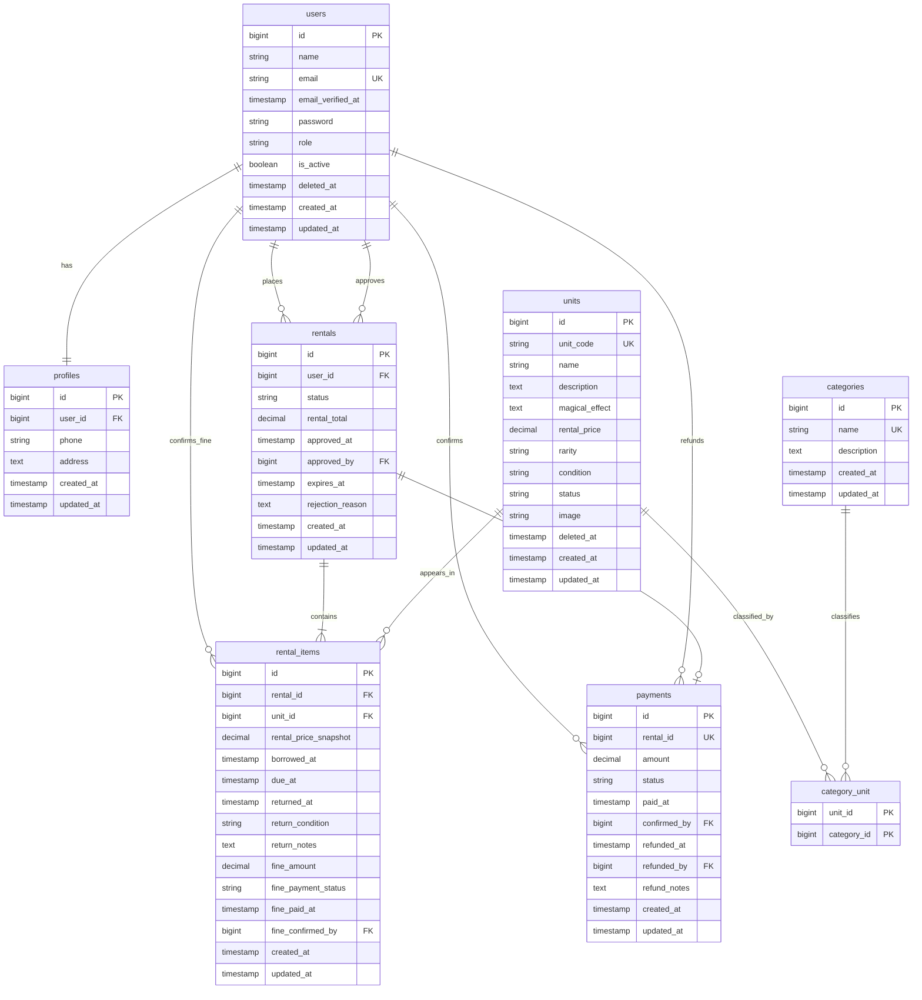

# PotionVault — ERD Final

ERD berikut diturunkan dari seluruh migration Laravel aktual. Nama tabel dan kolom tidak disederhanakan dari schema.

Diagram ini memodelkan business schema utama PotionVault. Tabel framework Laravel seperti `sessions`, `cache`, `jobs`, dan `password_reset_tokens` tidak ditampilkan karena berada di luar ERD bisnis aplikasi.

## Constraint dan index penting

- `users.email`, `units.unit_code`, dan `categories.name` unik.
- `profiles.user_id` unik untuk relasi satu profile per user.
- `category_unit` memakai primary key gabungan `unit_id, category_id`.
- `payments.rental_id` unik sehingga satu rental memiliki paling banyak satu payment.
- `rental_items(rental_id, unit_id)` unik.
- Index rental pada `(user_id, status)` dan `(status, expires_at)`.
- Index item pada `(unit_id, returned_at)`.
- `users` dan `units` memakai soft delete.
- Foreign key memakai cascade/null-on-delete sesuai migration aktual.

Kolom waktu dan catatan yang dapat belum terisi digambarkan dengan nama kolom aktual; migration menetapkan nullable pada `email_verified_at`, data profile, field approval/expiry, field return/fine, serta field payment/refund yang belum terjadi.
