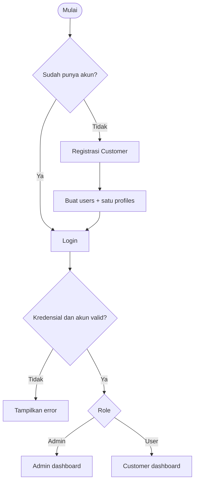
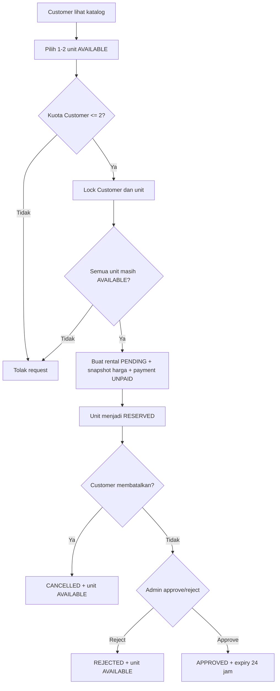
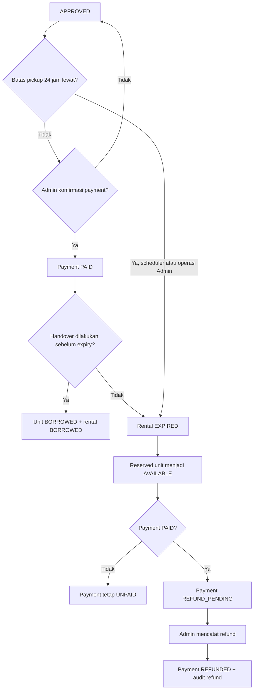
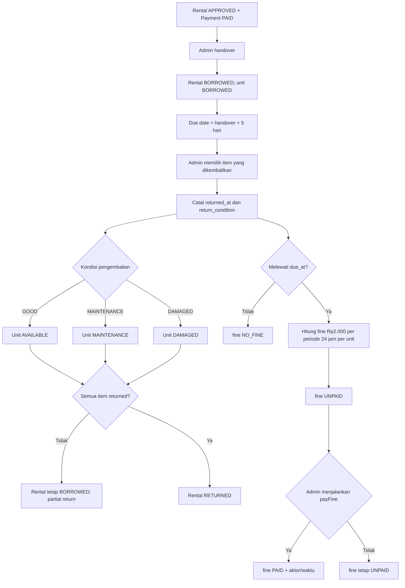

# PotionVault — Flowcharts Final

Diagram berikut menggambarkan workflow aktual Laravel, termasuk pemisahan status rental, payment, fine, dan unit.

## 1. Registration dan login

## 2. Rental request sampai approval

## 3. Expiry, payment, handover, dan paid-but-expired refund

## 4. Handover, return, fine, dan completion

### Ringkasan status

| Domain | Status dan makna |
|---|---|
| Rental | `PENDING`, `APPROVED`, `REJECTED`, `CANCELLED`, `EXPIRED`, `BORROWED`, `RETURNED` |
| Payment | `UNPAID`, `PAID`, `REFUND_PENDING`, `REFUNDED` |
| Unit | `AVAILABLE`, `RESERVED`, `BORROWED`, `MAINTENANCE`, `DAMAGED`, `DEACTIVATED` |
| Fine | `NO_FINE`, `UNPAID`, `PAID` |

`OVERDUE` merupakan status tampilan/query berdasarkan `due_at` yang telah lewat dan item belum dikembalikan; tidak ada kolom status `OVERDUE` pada schema.
